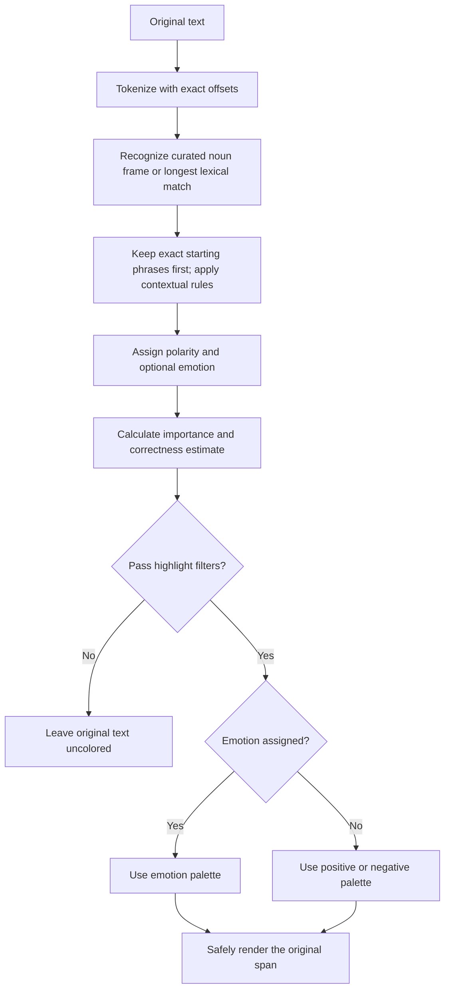

# How textheat decides what to highlight and which color to use

## Short answer

textheat does **not** color every word or assign colors based on the overall mood of a sentence. It finds recognized emotional words and phrases, adjusts their scores using nearby context, checks whether they are important and sufficiently unambiguous, then chooses a color from their emotion or polarity.

The default engine is a fast, local **English dictionary-and-rules algorithm**. It is not a trained language model, a reinforcement-learning system, or a statistically calibrated predictor.

## 1. Preserve the original text

The [tokenizer](../src/core/tokenize.ts) identifies words, contractions, and punctuation. It records zero-based, end-exclusive **UTF-16 offsets**, so each candidate refers to an exact slice of the original input.

Matching uses normalized lowercase text and normalized apostrophes, but rendering preserves the original capitalization, Unicode, punctuation, spacing, and word order. Whitespace is not itself a token.

## 2. Find emotional evidence

The [lexicon](../src/core/lexicon.ts) maps recognized words and phrases to:

- A signed sentiment score: positive means positive polarity, negative means negative polarity.
- An optional emotion such as joy, anger, sadness, fear, or surprise.

Examples of actual base scores:

| Entry | Base score | Optional emotion |
| --- | ---: | --- |
| good | 1.8 | None |
| beautiful | 2.8 | None |
| love | 3.0 | Joy |
| terrible | -3.5 | None |
| frustrating | -2.8 | Anger |
| sad | -2.6 | Sadness |
| anxious | -2.5 | Fear |
| not bad | 0.9 | None |
| crashes constantly | -3.0 | None |

The merged dictionary contains **5,981 unique entries: 1,850 words and 4,131 phrases**, with a derived maximum phrase length of **12 words**. The latest review layer contributes **339 individually authored keys: 213 words and 126 phrases**, with **no template generation in this layer**. Its vocabulary and scores are original, not imported from an external corpus, third-party dictionary, or training dataset. Earlier domain additions include constrained review-template combinations such as “the SUBJECT was PREDICATE”: subjects and predicates are combined only within authored compatibility families, not an unrestricted adjective/noun product. Template counts describe exact recognized keys, not measured accuracy or general sentence understanding. Spelling variants and inflections are explicit entries, not stemming.

Merge precedence is **original compact baseline > earlier expansion > domain additions > latest review additions** for duplicate keys; the 1,392 legacy entries retain their scores and emotions. The frozen public `lexiconStats` object reports `{ entries: 5981, words: 1850, phrases: 4131, maxPhraseWords: 12 }` from the merged keys, not source-row counts or estimated coverage. It is exported from the root, core, and browser entry points; see [lexicon statistics](API.md#lexicon-statistics).

The matcher recognizes curated bounded noun frames before individual lexical terms, but **existing exact multiword phrases at the frame's starting token retain precedence**. When no noun frame applies, it chooses the longest recognized lexical match. Phrase/frame words must be separated by spaces or tabs rather than punctuation, newlines, or hyphens. Matched words are consumed together, preventing nested highlights for a phrase and its component words. A recognized negative noun frame therefore does not paint a subjective descriptor independently green inside negative problems. Internal negators, degree words, and modal words of dictionary phrases keep the phrase's authored reading; they are not separately rescored. For example, “the purchase was not worth the asking price” is one authored negative phrase, not a positive phrase reversed by its internal “not.” A preceding external “not” can still reverse it. The token **like** is skipped unless its immediately preceding normalized token is **i, we, you, or they**, avoiding comparative “looks like” evidence; this narrow exception is not full grammatical analysis.

Unrecognized words do not generate evidence just because they sound unusual or appear in a negative sentence. For example, an unfamiliar adjective may produce no highlight even when a human understands the opinion.

## 3. Adjust the evidence using nearby context

The [contextual scorer](../src/core/sentiment.ts) applies bounded rules, not full grammatical understanding.

### Curated noun-head frames

The [noun-context recognizer](../src/core/noun-context.ts) handles **PREFIX VERB [any/a/no] [0–3 DESCRIPTORS] HEAD** as one negated-observation span. The lists are closed:

- **Prefixes:** don't, doesn't, didn't, can't, cannot, couldn't, won't, wouldn't, shouldn't, haven't, hasn't, not, never, dont. Curly apostrophes normalize to the same contractions.
- **Verbs:** see, find, notice, detect, encounter, experience, have.
- **Descriptors:** functional, technical, major, minor, serious, recurring, performance, usability, operational, structural, critical, intermittent, persistent, significant, severe, unexpected, known, potential, practical.
- **Heads:** problem/problems, issue/issues, bug/bugs, error/errors, defect/defects, flaw/flaws, glitch/glitches, delay/delays, failure/failures, crash/crashes.

Zero descriptors are allowed in an observation; the determiner is optional and limited to **any, a, no**. Recognition cannot cross punctuation, newlines, conjunctions, an unknown descriptor, or a fourth descriptor. Spaces and tabs are allowed, and original UTF-16 offsets and spelling are preserved. An exact dictionary phrase at the starting token (for example, “no problem”) still wins with its original score.

The negative head controls polarity. If it has a negative standalone lexeme, use that; otherwise the frame-only fallback scores are **problem -1.7, issue -2, bug -2.5, error -1.5, defect/flaw/glitch -2, delay -1.5, failure -2.5, crash -2.4**, with the same fallback for each plural. These fallbacks do **not** add head aliases or standalone lexemes to the dictionary, and the frame itself is not a generated dictionary entry.

For observations, multiply the head score by **-0.8**, with **no 1.15 descriptor multiplier**. An additional internal **no** multiplies by **-0.7**; odd external negation later multiplies by **-0.7** once. Thus “dont see any functional problems” yields $-1.7 \times -0.8 = +1.36$, while “don't see no functional problems” yields $1.36 \times -0.7 = -0.952$. External degree and contrast modifiers still apply once.

Outside observations, **1–3 DESCRIPTORS HEAD** and **no [0–3 DESCRIPTORS] HEAD** are bounded noun compositions. Descriptors multiply the head score by **1.15**; explicit **no** then multiplies by **-0.7**. “Functional problems” is one negative span with $-1.7 \times 1.15 = -1.955$, not a green adjective beside a fault. “No functional problems” yields $-1.955 \times -0.7 = +1.3685$. Descriptorless “no problems” is also eligible, unless an exact starting phrase takes precedence.

The rules are `contextual-noun-head` plus `negative-noun-observation` or `negative-noun-composition`; negated observations also record `absence-of-negative` and `negation-scope`. Missing-apostrophe **dont** is recognized only as a complete observation-frame prefix (`observation-negator-spelling`), not a global negator: “dont useful” does not reverse useful. The specific typo **funcitonal** is accepted only as a descriptor inside a complete observation (`observation-descriptor-typo`), not in “funcitonal problems” or “no funcitonal problems.” There is **no general fuzzy spelling correction**, stemming, or grammatical parser.

### Phrase composition

A positive term immediately followed by a recognized negative emotional noun takes the noun's polarity. For example, **“great disappointment”** becomes a single negative phrase instead of highlighting “great” positively.

The composed score is the negative noun's base score multiplied by **1.15**, replacing the positive entry's score and emotion with the noun's. The exact head list is **disappointment, failure, disaster, waste, problem, mess, pain, defect, defects, flaw, flaws, failures, glitch, glitches, malfunction, malfunctions**. The noun must itself have a negative lexicon score and immediately follow the positive match with a space/tab-only gap. “Great support” is not a negative-head composition; punctuation or a newline blocks composition.

### Degree modifiers

Nearby modifiers multiply the score:

| Modifier | Multiplier |
| --- | ---: |
| very | 1.35 |
| really | 1.25 |
| extremely | 1.60 |
| absolutely | 1.50 |
| incredibly | 1.50 |
| so / too | 1.20 |
| slightly | 0.65 |
| somewhat | 0.75 |
| barely | 0.50 |

Adjacent modifiers can be included in the highlighted span, as in **“very good”** or **“absolutely beautiful.”** The backward context window is at most eight tokens, so this is a proximity rule—not a dependency parser. Multiple recognized modifiers multiply together. The scan stops at a non-word token, a scope boundary (`and`, `or`, `because`, `if`, `unless`, `when`), or a previous consumed evidence span; sentence punctuation, commas, newlines, and contrast words also establish a new scope.

### Negation

The scorer looks backward through up to **eight tokens** for negators, including contractions such as “isn't,” “don't,” and “can't.”

An odd number of scoped negators reverses the score and reduces its magnitude:

$$s_{\text{negated}} = -0.7s$$

The highlighted span can extend backward to include the negator and intervening text. For example, **“don't think the interface is good”** can be one negative span.

Negation uses the same bounded backward scan as degree modifiers. The complete negator set is **not, no, never, neither, hardly, don't, doesn't, didn't, isn't, wasn't, aren't, weren't, can't, cannot, couldn't, won't, wouldn't, shouldn't, haven't, hasn't**. Even counts leave polarity unchanged; an odd count applies **one** -0.7 multiplier, not one per negator.

Only these adjacent, space/tab-separated exceptions suppress that cue's negation: **not only**, **not just**, **not merely**, **not simply**, and **no doubt**. **Without doubt** also records `negation-exception`, expressing certainty; `without` is not a general negator. Exceptions do not cancel another actual negator: “not just not reliable” and “no doubt not reliable” still reverse reliable.

Some expressions are direct lexicon phrases rather than reversals:

- **“not good”** has a predefined negative score of -1.8.
- **“not bad”** has a predefined mildly positive score of 0.9.

When ordinary scoped negation reverses a term, its original emotion is removed. “Not happy” therefore does not retain a joy color. External negation applies after the following narrow absence/lack and comparative rules, even when the matched phrase already contains internal negation.

### Listed absence and lack frames

These are exact local frames, not a general interpretation of absence:

| Frame | Listed noun | Context-only fallback when no standalone entry exists |
| --- | --- | --- |
| `without NOUN`, `free of NOUN`, `free from NOUN` | bugs, errors, problems, delays | bugs → buggy; errors → error; problems → problem; delays → slow |
| `lack of NOUN`, `lacks NOUN` | support, reliability | support → helpful; reliability → reliability (already a standalone entry) |

The frame's words must be adjacent word tokens with space/tab-only gaps in the current scope. It applies only to a **single-word** noun match: absence requires a negative entry and lack requires a positive entry. The existing standalone entry takes precedence; an alias is consulted only when no lexical match exists and never creates a standalone noun score. Currently bugs, errors, problems, delays, and support use those contextual fallbacks; reliability uses its own score.

Both rules multiply the score by **-0.7**, include the frame prefix in the evidence span, and remove emotion. Thus “without errors” uses error's -1.5 score to produce +1.05; “lack of support” uses helpful's +2 score to produce -1.4. A preceding external negator is applied afterward and multiplies by -0.7 again: “not lack of support” produces $2 \times 0.49 = 0.98$. “Without reliable support” is not one of these frames, and punctuation/newlines cannot join a frame.

### Listed comparisons and narrow degree ambiguity

Only single-word **useful, reliable, helpful, efficient, responsive, intuitive, usable** matches immediately preceded by **less** or **more** receive `comparative-degree`: less multiplies by **0.65**, more by **1.15**, and the preceding word is included in the span. “Less useful” remains positive, not a reversal; “not more reliable” applies $2 \times 1.15 \times -0.7 = -1.61$.

Two narrow ambiguity checks retain the lexical/negation score rather than inventing an arbitrary reversal:

- **too ADJECTIVE to ACTION**: a single-word adjective from **slow, fast, difficult, easy, reliable, useful, expensive, complicated**, and an action from **use, work, navigate, read, afford, recommend**, with space/tab-only adjacency throughout. `too` still has its normal **1.20** degree multiplier. The rule is `excess-to-frame`; “too fast to use” can remain lexically positive while being withheld as ambiguous.
- **not QUALITY enough**: more precisely, an **odd scoped negator count** plus a single-word quality from the comparison list immediately followed by space/tab-separated **enough**. The rule is `insufficient-enough-frame`; ordinary -0.7 negation remains intact. Other listed negators can trigger it too, not just “not.”

Either check sets the heuristic correctness estimate to **0.44**. The trailing “to ACTION” or “enough” is a cue, not part of the evidence span. “Too beautiful to describe” is outside these lists, and punctuation/newlines block these adjacency checks.

### Contrast

Words such as **but**, **however**, **yet**, **although**, and **though** start a new context scope. Subsequent evidence receives a **1.10** multiplier until punctuation resets that weight.

This emphasizes the following opinion slightly; it does not recolor every word in the clause or reverse earlier positive evidence.

### Punctuation and capitalization

- Up to three immediately following exclamation marks multiply strength by $1 + 0.08n$, where $n$ is the number of marks.
- An uppercase emotional token receives a **1.15** multiplier if there is also a non-uppercase word elsewhere in the input. An entirely uppercase input does not receive this bonus automatically.

Exclamation marks affect scoring but are not included in the emotional word's highlighted span.

### Emoji

A small curated set of emoji symbols is standalone evidence (`emoji-symbol` rule), scored conservatively below equivalent words. Faces and unambiguous gestures are listed; standalone heart symbols are deliberately excluded because they serve as decoration at least as often as sentiment. An emoji does not join phrases and is not negated or intensified by neighbouring words, but up to three trailing exclamation marks emphasize it exactly like lexical evidence.

After adjustments, signed scores are clamped to **[-4, 4]**. Positive scores produce positive polarity, negative scores negative polarity, and zero neutral polarity.

### Scoring precedence

In order: **curated noun-frame recognition (exact starting dictionary phrases retain precedence), otherwise longest lexical match → legacy negative-noun composition → degree and contrast multiplication → noun-frame scaling → listed absence/lack reversal → listed less/more scaling → odd external negation → narrow degree ambiguity checks → exclamation and capitalization emphasis → clamp**. Hypothetical cues are checked separately before the modifier scan; they change correctness/abstention, not the signed score. Emotion comes from the selected lexical entry or composed noun, but any ordinary negation, contextual noun-frame negation, absence, or lack reversal removes it, even if two reversals restore positive polarity.

## 4. Handle uncertainty separately from strength

The engine assigns a hand-defined **heuristic correctness estimate**:

| Situation | Heuristic estimate |
| --- | ---: |
| Ambiguity cue present | 0.44 |
| Ordinary scoped negation, negated noun frame, listed absence, or listed lack | 0.64 |
| Multiword match or composed phrase, otherwise | 0.86 |
| Single-word match, otherwise | 0.78 |

Ambiguity cues include:

- A bounded preceding hedge or hypothetical cue: **maybe, perhaps, might, may, could, possibly, apparently, seems, seem, if, unless, would** (`hypothetical-scope`). This independent backward scan examines at most **eight tokens** within the current scope, stopping at non-word tokens, contrasts, or `and`/`or`/`because`. Unlike the modifier/negation scan, it can look past earlier evidence in the same scope. `if`/`unless` establish a new scope and can themselves be the cue; cues inside a matched dictionary phrase are not reinterpreted. Observation frames include their starting prefix in this check; **couldn't/wouldn't/shouldn't** also mark the observation hypothetical.
- The listed excess-to or negated-enough degree frames above.
- A question mark within a bounded forward clause window.
- A narrow possible-irony pattern: positive praise near “another” or “again” and a recognized negative event, as in **“Great, another crash.”**

Forward checks examine at most **ten tokens** and stop at newlines, contrasts, `and`/`or`/`because`/`if`/`unless`/`when`, or sentence punctuation (`. ! ? ; :`). Commas do not stop this forward check, allowing “Great, another crash.” The irony check requires a positive selected entry, “another” or “again,” and a forward lexicon entry with score **less than -1**. These are conservative warning cues, not general sarcasm detection. Hypothetical scope does not leak across sentences, newlines, commas, contrasts, or coordinating boundaries, and a cue more than eight tokens back does not apply.

The table is a precedence order: ambiguity wins over reversal, which wins over phrase/single-word defaults. “If the interface is reliable” retains score +2 but has estimate 0.44 and is normally unhighlighted; it is not interpreted as an asserted outcome.

The default `confidence` field is **null**. `heuristicConfidence` is not a learned probability or proof of correctness. If externally fitted Platt calibration parameters are supplied, the calibrated value is used for the correctness filter instead; the caller remains responsible for fitting and validating those parameters. See [calibration guidance](CALIBRATION.md).

## 5. Calculate emotional importance

The [importance function](../src/core/importance.ts) uses the adjusted sentiment magnitude plus a small bonus for an explicit emotion:

$$I = \min\left(1,\max\left(0,\frac{|s|}{4}+b\right)\right)$$

where $b=0.08$ when an emotion is assigned and $b=0$ otherwise.

Importance answers **“How strong and emotionally specific is this evidence?”** It does not answer **“How likely is the prediction to be correct?”**

## 6. Decide whether to add a highlight

The [highlight filter](../src/core/options.ts) requires **all** of the following:

1. Polarity is not neutral.
2. Importance is at least the configured threshold; default **0.30**.
3. Available calibrated confidence, or otherwise heuristic correctness, is at least the configured minimum; default **0.50**.
4. If an emotion filter is supplied, the candidate has one of those emotions.

Equality passes: an importance of exactly 0.30 meets a threshold of 0.30.

Consequences:

- Lowering the importance threshold can expose weak **recognized** evidence.
- It cannot recognize words absent from the lexicon.
- Lowering importance alone does not bypass uncertainty abstention.
- “Not bad” has importance 0.225, so it is normally uncolored at the default threshold despite being mildly positive.
- A candidate with an ambiguity estimate of 0.44 is normally omitted because it fails the default minimum correctness of 0.50.

Unhighlighted evidence can still appear in clause/aspect analysis. An omitted highlight is not necessarily absent evidence, and absent evidence is not proof of neutral meaning.

## 7. Choose the color

Color selection is categorical:

**If an emotion is assigned, use its color. Otherwise, use the polarity color.**

Importance affects whether a span appears, not the hue or opacity of the default color. Overall sentence or document sentiment does not determine individual span colors.

The [default theme](../src/render/themes.ts) is:

| Category | Background | Text | Example |
| --- | --- | --- | --- |
| Positive | `#D1FAE5` | `#065F46` | beautiful |
| Negative | `#FEE2E2` | `#991B1B` | terrible |
| Joy | `#FEF3C7` | `#92400E` | love |
| Anger | `#FFEDD5` | `#9A3412` | frustrating |
| Sadness | `#DBEAFE` | `#1E40AF` | sad |
| Fear / anxiety | `#EDE9FE` | `#5B21B6` | anxious |
| Surprise | `#CFFAFE` | `#155E75` | pleasant surprise |

Neutral and uncertain palettes exist in theme configuration, but the default pipeline does **not** automatically paint neutral words or ambiguous spans with them. Uncertainty usually means abstaining from colored output.

Browser DOM rendering without an explicit theme, and the extension's default **Adaptive** theme, use `getPageTheme(element)`. It composites solid ancestor background colors (including transparency), chooses a light/dark category palette from the resulting surface, and blends category backgrounds with that surface. Foregrounds are checked against the emitted opaque highlight backgrounds; black or white is used when necessary to ensure at least **4.5:1 contrast** within each highlight. Category meanings remain the same; the page's sentiment does not determine the palette.

The extension recolors existing highlights when ancestor classes/styles or the OS color scheme change, without reinterpreting sentiment or changing the text. Browser `mount`/`update` resample at rendering time; call `update` again after your application changes theme. Background images, gradients, unsupported color formats, filters, and external CSS overrides cannot be fully measured; solid background colors are used as a fallback. Contrast is a property of the generated foreground/background pair, not a guarantee about arbitrary page effects.

Server/string HTML remains deterministic and uses the static default palette. Explicit default, dark, and custom themes keep their exact colors and change presentation only. Custom colors accept six-digit hexadecimal values only. The extension additionally offers a presentation-only high-contrast palette. All palette calculations run locally and store no page text.

## 8. Worked examples at the default settings

These examples assume the default light theme, threshold 0.30, minimum correctness 0.50, no external calibration, and no emotion filter. Values are rounded for display.

| Input / candidate | Adjusted score | Importance | Highlight and color |
| --- | ---: | ---: | --- |
| good | 1.80 | 0.45 | Yes: positive green |
| very good | 2.43 | 0.61 | Yes: positive green; phrase includes “very” |
| not good | -1.80 | 0.45 | Yes: negative red |
| not bad | 0.90 | 0.225 | No: below importance threshold |
| love | 3.00 | 0.83 | Yes: joy yellow, not positive green |
| frustrating | -2.80 | 0.78 | Yes: anger orange, not negative red |
| absolutely beautiful | 4.00, after clamping | 1.00 | Yes: positive green |
| great disappointment | -3.22 | 0.885 | Yes: sadness blue |
| functional problems | -1.955 | 0.48875 | Yes: one negative red span, not a separate green adjective |
| dont see any functional problems | +1.36 | 0.34 | Yes: full-span positive green; correctness 0.64, no emotion |
| no functional problems | +1.3685 | 0.342125 | Yes: positive green; correctness 0.64 |
| don't see no functional problems | -0.952 | 0.238 | No: negative evidence below importance threshold |
| don't think there are no problems | -0.833 | 0.20825 | No: negative evidence below importance threshold |
| don't think there are no functional problems | -0.95795 | 0.2394875 | No: negative evidence below importance threshold |
| maybe good | 1.80 | 0.45 | No: ambiguity estimate 0.44 fails the correctness cutoff |
| unfamiliar factual words | No candidate | Not calculated | No highlight |

In **“The interface is beautiful, but the app crashes constantly,”** the engine highlights “beautiful” positively and “crashes constantly” negatively. Aspect attribution associates them with interface and app respectively, but these target nouns are not automatically colored.

The [noun-context regressions](../tests/noun-context.test.ts) verify the observation and double-negation cases above against actual source outputs. In “I dont see any functional problems.” the highlighted slice is exactly **“dont see any functional problems”**, not the subject or punctuation; `confidence` remains null. External negation in “don't think there are no problems” gives $-1.7 \times -0.7 \times -0.7 = -0.833$; descriptors add 1.15 in its “no functional problems” variant. These negative scores remain clause evidence even when they do not qualify for display—none becomes falsely green. “If I dont see any functional problems.” and “I dont see any functional problems?” retain **+1.36 / 0.34**, but correctness **0.44** causes default abstention. This is bounded heuristic behavior, not a general interpretation of double negatives, questions, or conditionals.

## 9. What attribution does—and does not—change

The [context analysis layer](../src/core/context.ts) provides deterministic grammatical hints, clause sentiment, and likely opinion targets. Unknown alphabetic words default to noun candidates; these hints are not a trained tagger or semantic parser.

- Ordinary noun compounds expand backward/forward to at most **three contiguous noun tokens**, with space/tab-only gaps and no emotional noun heads.
- Explicit coordinated subjects can share a predicate: “The interface and navigation are intuitive.” The recognizer looks back within **18 tokens** before **is, are, was, were**, admitting at most **three targets**, each at most **three noun tokens**, joined by **and**, with optional determiners. It refuses overlong compounds or lists rather than truncating a recognized coordinated group. Recognized subject-list conjunctions are kept within the clause; this is not a rule for arbitrary noun lists or pronouns.
- A shared target (including a recognized coordinated group) can carry across `and`/`or` predicates only when the next segment has **no noun or pronoun**; new subjects, sentences, and contrasts block inheritance.
- Listed opinion verbs (**love, loved, loves, like, likes, liked, hate, hated, hates, enjoy, enjoyed, enjoys, adore, adores, recommend, recommends**) prefer a following explicit object, not a preceding subject (`opinion-verb-object`). Detection examines at most **16 tokens** inside the evidence span; object lookup examines at most **eight tokens** from its start and stops after the span at a pronoun, verb, conjunction, or punctuation. Ordinary preceding target lookup is bounded to **ten tokens** within the segment. These are proximity heuristics, not guaranteed grammatical analysis.

There is no pronoun/coreference resolution: “The interface loved the navigation” targets navigation, but “The interface loved it” does not resolve “it” to a noun. New vocabulary can be recognized without any identifiable aspect; unfamiliar words can also be incorrectly treated as noun candidates.

These results are explanatory metadata: **aspect attribution does not change the word's polarity, importance, correctness estimate, or color**. For “The interface is good and beautiful,” both opinion spans can be attributed to interface, while interface itself stays uncolored.

## 10. Browser extension and optional native models

The extension calls the same public analyzer on eligible text nodes. Its modes determine **when and where** analysis runs:

- Off: no processing.
- Auto: progressive processing near the viewport, then once-only visibility animation.
- Manual: explicitly activated page processing or a text-check panel.

The extension does not use different sentiment scores. Its animation reveals an already-decided color; animation timing is not an emotional measurement. Because analysis is per text node, dictionary phrases and curated noun/observation frames split across separate HTML elements can lose shared context. There is no cross-node grammatical parser. See [extension limitations](EXTENSION.md).

The optional browser-native adapter in the library/demo supplies an **independent second opinion** when requested and available. It does not silently overwrite local highlights or invent model confidence. The extension currently uses the local engine only.

## 11. Inspecting a decision

Structured predictions expose `score`, `importance`, `sentiment`, optional `emotion`, `confidence`, `heuristicConfidence`, `rules`, `ambiguity`, and `explanation`.

In the demo, expand **“Why was this phrase highlighted—or omitted?”** to inspect recognized evidence and its display status. Hover explanations are optional. A phrase can be:

- Recognized and highlighted.
- Recognized but below the importance threshold.
- Recognized but withheld due to uncertainty.
- Recognized without an identifiable opinion target.
- Not recognized because the vocabulary or rule system lacks coverage.

The implementation remains a useful, explainable baseline—not full sentence understanding. Sarcasm, implicit sentiment, unfamiliar expressions, quoted opinions, domain-specific meanings, and complex grammar can still be misinterpreted.